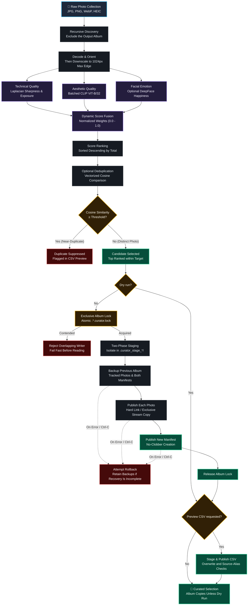

# 📸 AI Photo Curator

[](https://github.com/bhargavkukadiya/ai-photo-curator/actions/workflows/ci.yml)
[](https://opensource.org/licenses/MIT)
[](https://www.python.org/downloads/)
[](tests/)
[](https://pytorch.org/)
%20%7C%20CUDA%20%7C%20CPU-orange.svg)


> **Production-grade, AI-powered photo curator that automatically ranks, deduplicates, and curates the best photos from large collections for your albums with staged writes and recoverable rollback.**

---

## 📑 Table of Contents

- [✨ Features](#features)
- [🧠 How It Works](#how-it-works)
- [⚡ Performance & Benchmarks](#performance--benchmarks)
- [📦 Installation](#installation)
- [🚀 Quick Start](#quick-start)
- [⚙️ Advanced Usage](#advanced-usage)
- [🛠️ CLI Reference](#cli-reference)
- [📊 Preview CSV Schema](#preview-csv-schema)
- [🖼️ Supported Formats](#supported-formats)
- [🛡️ Transactional Safety & Security](#transactional-safety--security)
- [🧪 Testing & Development](#testing--development)
- [🤝 Community & Contributing](#community--contributing)
- [📄 License & Acknowledgements](#license--acknowledgements)

---

<a id="features"></a>

## ✨ Features

- 🎯 **Multi-Signal AI Quality Engine**:
  - **Technical Quality (40%)**: Standardized Laplacian variance for edge sharpness plus normalized luminance exposure.
  - **Aesthetic Quality (40%)**: Batched OpenAI CLIP (`ViT-B/32`) cosine similarity scored against configurable semantic reference prompts.
  - **Facial Emotion Detection (20%, optional)**: DeepFace facial analysis to prioritize genuine smiles and joy in group and portrait photos.
- ⚡ **Vectorized Burst-Shot Deduplication**: Selected embeddings are kept unit-normalized in one preallocated matrix, so each candidate costs a single matrix-vector product when suppressing redundant burst shots by cosine similarity (`--dedup_threshold`).
- 🛡️ **Two-Phase Transactional Commit**:
  - Isolated temporary staging (`.curator_stage_*`) with automatic rollback on errors.
  - Non-destructive JSON manifest tracking (`.curator_manifest.json`) and untracked-file protection.
  - Exclusive-create fallback (`O_CREAT | O_EXCL`) for filesystems without hard links, preserving original file metadata (`copystat`).
- 💾 **Memory-Efficient Batch Ingestion**: Downsamples photos after decode to a 1024px maximum edge. The retained PIL RGB and OpenCV BGR pixel buffers use at most ~6.29 MB per image (~201 MB for a batch of 32), excluding model memory and temporary allocations.
- 🚀 **Hardware Accelerated**: Explicit device selection for Apple Silicon (`mps`), NVIDIA GPUs (`cuda`), and multi-core `cpu`.
- 📊 **Actionable Dry-Run & CSV Previews**: Use `--dryrun` to export rankings with explicit status annotations (`Selected`, `Duplicate_Suppressed`, `Rank_Cutoff`) before copying. Normal runs export the CSV after the album commit.
- 🧪 **Comprehensive In-Memory Test Suite**: Unit and security regression tests with mocked neural inference, plus optional backend smoke checks.

---

The default weights are 40% technical, 40% aesthetic, and 20% emotion when the emotion backend initializes successfully. Otherwise, the two active default weights become 50% each.

<a id="how-it-works"></a>

## 🧠 How It Works



---

<a id="performance--benchmarks"></a>

## ⚡ Performance & Benchmarks

The following measurements were recorded for the original v1.0.0 release; they are historical examples, not benchmarks rerun against the current dependency lock. Runtime and peak memory depend on hardware, image format, aspect ratio, and installed backends.

| Operation / Metric | Previous Baseline | Optimized (v1.0.0) | Notes |
|---|---|---|---|
| **Burst Deduplication (5,000 photos)** | `4.245s` (Scalar loop) | **`0.114s`** (Vectorized) | **37× faster** batch matrix similarity |
| **Retained Buffers per 48MP Photo (8000×6000)** | ~288 MB retained (Dual PIL RGB + OpenCV BGR) | **~4.72 MB** retained (Dual 1024px buffers) | **>98% retained buffer reduction** |
| **Retained Batch Memory (32 Photos in RAM)** | ~9.2 GB uncompressed | **~151 MB** downscaled | Prevents cumulative batch accumulation |
| **Transient Decode Peak (Single 48MP JPEG)** | ~569 MiB peak RSS | ~569 MiB peak RSS | Full-resolution initial decode & EXIF transpose |
| **Original Release Test Suite (95 tests)** | N/A | **~2.4s** | Fast isolated mock & unit tests |
| **Distinct-Photo Deduplication (5,000 selected, 512-d)** | `3.7s` (re-stacked selections) | **`0.15s`** (preallocated unit matrix) | Unreleased; one Apple Silicon CPU run, `--target 5000` |

> [!NOTE]
> The ~4.72 MB buffer example is for an 8000×6000 image resized to 1024×768. A square image can retain two 1024×1024 RGB/BGR buffers (~6.29 MB combined, or ~201 MB for 32 photos). These figures cover pixel buffers only. Full-resolution decoding, EXIF transposition, high-bit-depth conversion, model weights, and inference need additional memory.

---

<a id="installation"></a>

## 📦 Installation

### Option 1: Install from Source (Recommended)

```bash
# 1. Clone the repository
git clone https://github.com/bhargavkukadiya/ai-photo-curator.git
cd ai-photo-curator

# 2. Create and activate a virtual environment
python3 -m venv .venv
source .venv/bin/activate  # On Windows: .venv\Scripts\activate

# 3. Install core dependencies
pip install -e .
```

Python 3.11 or later is required. Older Python dependency branches have been removed so installations can use patched image decoders and ML backends.

After installation, the `ai-photo-curator` CLI command and the backwards-compatible `photo-curator` alias are available while that environment is active. You can also run `python -m photo_curator` or the legacy `python album_selector.py` from the checkout.

### Option 2: Install with Optional Extras

```bash
# Optional: Facial emotion scoring (DeepFace)
pip install -e ".[emotion]"

# Optional: Apple/Android HEIC & HEIF photo support
pip install -e ".[heic]"

# Install everything (Core + Emotion + HEIC + Test Suite)
pip install -e ".[all,dev]"
```

> [!NOTE]
> On the first run, the CLIP model (`clip-ViT-B-32`, ~350 MB) downloads automatically into the Hugging Face cache (normally `~/.cache/huggingface/`).

DeepFace initializes only when emotion scoring is enabled. Expected backend initialization failures disable emotion scoring and rebalance the remaining weights. Real facial analysis may download additional DeepFace model weights on first use.

### Option 3: Reproduce the Dependency Lock

```bash
python -m pip install --upgrade uv
uv sync --frozen
uv run --frozen ai-photo-curator --help
```

For optional backends, add `--extra emotion --extra heic` to both `uv sync` and `uv run`. A pip installation uses the version constraints in `pyproject.toml`; the frozen uv commands use the exact versions in `uv.lock`.

---

<a id="quick-start"></a>

## 🚀 Quick Start

### 1. Basic Curation

Select the top 50 photos from a collection and copy them to `./selected` with zero-padded index prefixes:

```bash
ai-photo-curator --input ./my_photos --output ./selected --target 50
```

### 2. Dry Run with Burst Deduplication & CSV Preview

Score all readable photos, suppress near-duplicates with similarity $\ge 0.90$ until the selection target is reached, and export rankings without copying:

```bash
ai-photo-curator \
  --input ./sample_photos \
  --output ./album \
  --target 5 \
  --dedup_threshold 0.90 \
  --no_deepface \
  --preview_csv preview_scores.csv \
  --dryrun
```

Historical sample scores from [sample_scores.csv](sample_scores.csv), with selection statuses illustrating the five-photo target above. Scores can vary with the model, dependency versions, and hardware; the checked-in CSV contains component scores without a `Status` column.

| Photo | Total Score | Technical | Aesthetic | Emotion | Status |
|---|---|---|---|---|---|
| `city_night.jpg` | **0.6832** | 0.9774 | 0.3889 | 0.0000 | `Selected` |
| `beach_sunset.jpg` | **0.6787** | 0.9836 | 0.3737 | 0.0000 | `Selected` |
| `ocean.jpg` | **0.6478** | 0.9604 | 0.3351 | 0.0000 | `Selected` |
| `mountain.jpg` | **0.6374** | 0.9360 | 0.3387 | 0.0000 | `Selected` |
| `flower.jpg` | **0.6303** | 0.8938 | 0.3668 | 0.0000 | `Selected` |
| `forest.jpg` | **0.6159** | 0.8542 | 0.3775 | 0.0000 | `Rank_Cutoff` |
| `bright_field.jpg` | **0.6081** | 0.8396 | 0.3765 | 0.0000 | `Rank_Cutoff` |
| `dark_alley.jpg` | **0.4870** | 0.6433 | 0.3308 | 0.0000 | `Rank_Cutoff` |
| `portrait.jpg` | **0.4526** | 0.5598 | 0.3455 | 0.0000 | `Rank_Cutoff` |
| `blurry_abstract.jpg` | **0.3825** | 0.3549 | 0.4102 | 0.0000 | `Rank_Cutoff` |

---

<a id="advanced-usage"></a>

## ⚙️ Advanced Usage

### Custom Scoring Weights

Customize curation for landscape and architectural photography (e.g. 50% sharpness, 50% aesthetics, zero emotion):

```bash
ai-photo-curator \
  --input ./nature_trip \
  --output ./album \
  --no_deepface \
  --weight_technical 0.5 \
  --weight_aesthetic 0.5
```

> [!TIP]
> When `--no_deepface` is passed or emotion scoring is unavailable, weights automatically rebalance dynamically so the composite score always spans the full `[0.0, 1.0]` scale.

### Hardware Acceleration

```bash
# Apple Silicon with MPS support
ai-photo-curator --input ./photos --output ./album --device mps --batch_size 32

# NVIDIA CUDA
ai-photo-curator --input ./photos --output ./album --device cuda --batch_size 64

# Multi-Core CPU
ai-photo-curator --input ./photos --output ./album --device cpu --batch_size 16
```

### Custom Aesthetic Prompts

Tailor aesthetic scoring for specific album themes:

```bash
# Family portraits
ai-photo-curator --input ./family --output ./album --ref_text "a warm happy family portrait with natural lighting"

# Architectural photography
ai-photo-curator --input ./travel --output ./album --ref_text "stunning architecture sharp symmetrical award-winning photograph"
```

---

<a id="cli-reference"></a>

## 🛠️ CLI Reference

| Flag | Type | Default | Description |
|---|:---:|:---:|---|
| `--input` | `Path` | *required* | Directory containing photos (scanned recursively). |
| `--output` | `Path` | *required* | Destination directory for selected photos. |
| `--target` | `int` | `200` | Maximum number of photos to select; fewer may remain after decoding or deduplication. |
| `--batch_size` | `int` | `32` | Batch size for neural CLIP inference. |
| `--device` | `str` | `cpu` | PyTorch execution device (`cpu`, `cuda`, or `mps`). |
| `--preview_csv` | `Path` | `None` | Export full rankings and selection status to CSV. |
| `--ref_text` | `str` | `"a beautiful photograph"` | Reference semantic prompt for aesthetic scoring. |
| `--weight_technical` | `float` | `0.4` | Weight for technical quality (sharpness + exposure). |
| `--weight_aesthetic` | `float` | `0.4` | Weight for CLIP aesthetic quality. |
| `--weight_emotion` | `float` | `0.2` | Weight for facial emotion happiness score. `0` skips loading and running DeepFace. |
| `--dedup_threshold` | `float` | `None` | Cosine similarity threshold `[0.0-1.0]` for duplicate suppression (e.g. `0.90`). |
| `--no_deepface` | `flag` | `false` | Disable facial emotion detection. |
| `--overwrite` | `flag` | `false` | Reuse a nonempty album, replace manifest-tracked photos, and permit replacement of an existing preview CSV. Untracked photo collisions are rejected. |
| `--dryrun` | `flag` | `false` | Score and rank without copying photos; a requested preview CSV is still written. |

`--target` and `--batch_size` must be positive integers. Weights must be finite and non-negative, with at least one positive active weight. `--dedup_threshold` must be finite and within `[0.0, 1.0]`; `1.0` also suppresses identical embeddings despite cosine roundoff. The requested device must be available.

The output cannot equal or contain the input directory. An output nested inside the input is allowed and excluded from discovery. Earlier albums nested inside the input (directories holding `.curator_manifest.json` or `.curator_manifest.txt`) are also skipped, so their copies do not compete with the originals; an input that is itself an album is still scanned. An existing nonempty output requires `--overwrite` for a copy run. Preview destinations must not be directories, symlinks, source-photo aliases, manifest filenames, or supported image filenames. Reports are exported after the album commit, so an export failure does not undo a successfully copied album.

---

<a id="preview-csv-schema"></a>

## 📊 Preview CSV Schema

When `--preview_csv <filename>.csv` is passed, Photo Curator writes a structured report with the following columns:

| Column | Type | Example | Description |
|---|:---:|:---:|---|
| `Path` | `str` | `photos/sunset.jpg` | Source photo path; relative or absolute according to `--input`. Formula-like paths receive a leading apostrophe. |
| `TotalScore` | `float` | `0.6786` | Normalized composite quality score `[0.0000, 1.0000]`. |
| `Technical` | `float` | `0.9836` | Sharpness (Laplacian variance) + balanced exposure score. |
| `Aesthetic` | `float` | `0.3737` | Rescaled CLIP cosine similarity against `--ref_text`. |
| `Emotion` | `float` | `0.0000` | Average happiness score across detected faces `[0.0, 1.0]`. |
| `Status` | `str` | `Selected` | Selection outcome: `Selected`, `Duplicate_Suppressed`, or `Rank_Cutoff`. |

---

`Rank_Cutoff` means selection stopped before this row was considered; it does not certify that the photo is distinct. Unreadable or unscorable images are skipped and omitted from the report. The Python `export_scores_csv()` API includes `Status` only when a status mapping is supplied; unmapped paths receive `Unselected`.

<a id="supported-formats"></a>

## 🖼️ Supported Formats

| Format | Extension | Decoder Engine | Notes |
|---|---|:---:|---|
| **JPEG** | `.jpg`, `.jpeg` | Pillow / OpenCV | Automatic EXIF orientation transpose |
| **PNG** | `.png` | Pillow / OpenCV | RGB/RGBA and normalized unsigned 16-bit grayscale |
| **WebP** | `.webp` | Pillow / OpenCV | Lossy and lossless WebP support |
| **BMP** | `.bmp` | Pillow / OpenCV | Standard uncompressed bitmaps |
| **TIFF** | `.tiff`, `.tif` | Pillow / OpenCV | RGB and 8-bit grayscale; unsigned 16-bit grayscale is normalized. Signed/32-bit integer and floating-point grayscale are skipped. |
| **HEIC / HEIF** | `.heic`, `.heif` | `pillow-heif` | Requires `pip install -e ".[heic]"` |

Pillow decodes the image and applies EXIF orientation; OpenCV receives an 8-bit BGR array for scoring. Copies preserve the original source bytes. Discovery uses the listed extensions, and decoding also checks the content format. For multi-frame inputs, the first frame is used for scoring.

---

<a id="transactional-safety--security"></a>

## 🛡️ Transactional Safety & Security

Photo Curator enforces strict filesystem integrity guarantees:

1. **Staged Commit**: Files are copied into an isolated temporary folder (`.curator_stage_<hash>`). Only upon successful scoring and staging are files moved to the destination folder via atomic links or `O_CREAT | O_EXCL` exclusive stream copy.
2. **Rollback & Recovery**: Transaction intent is recorded before filesystem changes, including backup renames and file publication. Errors and Ctrl-C trigger rollback. If restoration would overwrite a concurrent file, ownership is uncertain, or rollback is interrupted, recovery backups are retained. SIGKILL and power loss cannot run rollback. Files become visible individually; this is not an atomic album snapshot for concurrent readers.
3. **Path Traversal Protection**: Manifest entries are strictly checked against directory escape (`..`, `/`).
4. **Symlink Rejection**: Manifests and tracked entries reject symlinks to prevent symlink clobbering attacks.
5. **Untracked File Safety**: Photo and manifest publication use no-clobber operations. `--overwrite` permits reuse of a nonempty album and replacement of tracked files; it does not permit clobbering untracked photo destinations. The output directory must remain under the caller’s control during a run; the lock coordinates curator processes, not arbitrary external writers.
6. **Exclusive Album Writes**: An atomic lock directory beside the album (`.<album-name>.curator.lock`) rejects overlapping writers before manifest inspection. It is removed after success, failure, or Ctrl-C. After SIGKILL or a crash, confirm no writer is running and inspect any `.curator_backup_*` recovery directories before manually removing an abandoned lock.

CSV reports are staged before publication. Existing reports require `--overwrite`; symlinks and source-photo aliases are rejected. Allowed replacement swaps the directory entry instead of truncating the existing inode, preserving any other hard links and keeping the replaced report's permission bits; new reports get the usual umask-based permissions. Formula-like path cells are prefixed with an apostrophe for spreadsheet safety. Reports are written after successful photo copying, so `--preview_csv ./album/scores.csv` works for a fresh album without `--overwrite`. With `--dryrun`, the CSV is written without copying photos.

---

Original files and EXIF metadata, including any location information, are preserved in album copies. Only the advertised Pillow decoder formats are enabled. Unsigned 16-bit grayscale is scaled over 0–65535; floating-point HDR, signed or 32-bit integer grayscale, and out-of-range integer samples require explicit conversion before ingestion.

<a id="testing--development"></a>

## 🧪 Testing & Development

Run the test suite:

```bash
# Install the locked core and test dependencies
python -m pip install --upgrade uv
uv sync --frozen --extra dev

# Run the full unit and regression suite
uv run --frozen --extra dev pytest -v

# Run with verbose traceback
uv run --frozen --extra dev pytest -vv
```

Core tests mock ML inference and require no GPU or model downloads. Optional backend smoke tests run when the corresponding extras are installed.

CI tests the locked core on Ubuntu with Python 3.11–3.13 and on macOS/Windows with Python 3.12. Each core job also builds and smoke-tests the wheel and both console commands. A separate Ubuntu/Python 3.12 job installs the emotion and HEIC extras. The security job audits every distinct registry package/version in the lockfile. See [CONTRIBUTING.md](CONTRIBUTING.md) for matching local commands.

---

<a id="community--contributing"></a>

## 🤝 Community & Contributing

Contributions are warmly welcomed! Please review our community documents:

- [Contributing Guide](CONTRIBUTING.md) — Setup, code style, and PR guidelines.
- [Code of Conduct](CODE_OF_CONDUCT.md) — Community standards and enforcement.
- [Security Policy](SECURITY.md) — Vulnerability reporting and disclosure.
- [Changelog](CHANGELOG.md) — Historical release notes.

---

<a id="license--acknowledgements"></a>

## 📄 License & Acknowledgements

- Licensed under the [MIT License](LICENSE).
- **Core AI Technologies**:
  - [OpenAI CLIP](https://github.com/openai/CLIP) via [sentence-transformers](https://www.sbert.net/)
  - [DeepFace](https://github.com/serengil/deepface) by Sefik Ilkin Serengil (optional emotion detection, MIT; individual model licenses may differ)
  - [OpenCV](https://opencv.org/) & [Pillow](https://python-pillow.org/)
